<picture>
  <source media="(prefers-color-scheme: dark)" srcset="./assets/hero-dark.svg">
  <source media="(prefers-color-scheme: light)" srcset="./assets/hero-light.svg">
  
</picture>

<div align="center">

<br>

<strong>Computer Engineering · Systems Engineering · Embedded Systems</strong>

<br><br>

I design and build multidisciplinary systems spanning  
<strong>software, hardware, AI, automation, security, and infrastructure.</strong>

<br><br>

<a href="https://github.com/Keyboard-Lord">
  
</a>


<br><br>

<a href="#30-second-overview">Overview</a> ·
<a href="#selected-engineering-work">Projects</a> ·
<a href="#engineering-capabilities">Capabilities</a> ·
<a href="#embedded--hardware">Embedded</a> ·
<a href="#how-i-approach-engineering">Approach</a> ·
<a href="#current-direction">Direction</a>

</div>

---

## 30-Second Overview

### I build systems, not isolated components.

My work sits at the intersection of **software, embedded hardware, compute infrastructure, automation, and security**.

I am most interested in projects where several independently complicated pieces have to behave as **one reliable system**.

The recurring themes across my work are:

**Architecture · Integration · State · Validation · Failure Modes · Observability**

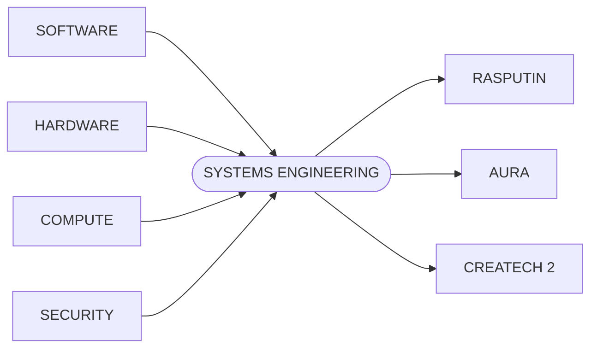

> [!IMPORTANT]
> I prefer demonstrating capability through systems I have actually built rather than presenting long lists of technologies without context.

---

## Selected Engineering Work

<table>
<tr>

<td width="33%" valign="top">

<h3 align="center">RASPUTIN-CODER</h3>

<p align="center"><strong>AI · Rust · Systems</strong></p>

<p>Local autonomous software engineering agent built around <strong>bounded execution, validation, checkpoints, recovery, and auditability</strong>.</p>

<strong>Problem</strong>

<p>AI agents can modify code quickly, but their own claim of success is not evidence that the resulting software actually works.</p>

<strong>What I built</strong>

<p>A system that separates agent execution from validation and attempts to produce machine-verifiable evidence of completion.</p>

<p>
<code>Rust</code>
<code>Local AI</code>
<code>Git</code>
<code>State</code>
<code>Testing</code>
</p>

<p align="center">
<a href="https://github.com/Keyboard-Lord/Rasputin-Coder"><strong>VIEW REPOSITORY →</strong></a>
</p>

</td>

<td width="33%" valign="top">

<h3 align="center">AURA PROTOCOL</h3>

<p align="center"><strong>Security · Protocols · Verification</strong></p>

<p>Experimental architecture exploring <strong>deterministic authorization, identity, computation, and verifiable outcomes</strong>.</p>

<strong>Problem</strong>

<p>Complex systems often rely on several layers of trust to establish whether an operation was authorized and correctly executed.</p>

<strong>What I built</strong>

<p>A protocol architecture exploring how authorization and execution can produce independently verifiable results.</p>

<p>
<code>Rust</code>
<code>TypeScript</code>
<code>Crypto</code>
<code>Verification</code>
</p>

<p align="center">
<a href="https://github.com/Keyboard-Lord/Aura-Protocol"><strong>VIEW REPOSITORY →</strong></a>
</p>

</td>

<td width="33%" valign="top">

<h3 align="center">CREATECH 2</h3>

<p align="center"><strong>Integration · Automation · Runtime</strong></p>

<p>Large-scale software integration project coordinating <strong>hundreds of independently designed systems</strong> into one progression architecture.</p>

<strong>Problem</strong>

<p>Independent software systems carry their own assumptions, dependencies, resources, progression, and interfaces.</p>

<strong>What I built</strong>

<p>An integration layer coordinating configuration, scripting, world generation, progression, compatibility, and runtime behavior.</p>

<p>
<code>Java</code>
<code>JavaScript</code>
<code>KubeJS</code>
<code>NeoForge</code>
</p>

<p align="center">
<a href="https://github.com/Keyboard-Lord/Createch-2"><strong>VIEW REPOSITORY →</strong></a>
</p>

</td>

</tr>
</table>

---

## Engineering Capabilities

<table>
<tr>

<td width="25%" valign="top">
<h3 align="center">BUILT</h3>
<hr>
<p><code>Systems Architecture</code></p>
<p><code>Rust</code></p>
<p><code>JavaScript</code></p>
<p><code>Linux</code></p>
<p><code>Git / GitHub</code></p>
<p><code>Automation</code></p>
<p><code>Local AI</code></p>
<p><code>Agent Systems</code></p>
<p><code>State Machines</code></p>
<p><code>Validation</code></p>
<p><code>Integration</code></p>
<p><code>Technical Docs</code></p>
</td>

<td width="25%" valign="top">
<h3 align="center">HANDS-ON</h3>
<hr>
<p><code>Python</code></p>
<p><code>Java</code></p>
<p><code>C</code></p>
<p><code>C++</code></p>
<p><code>Arduino</code></p>
<p><code>ESP32</code></p>
<p><code>Microcontrollers</code></p>
<p><code>Sensors</code></p>
<p><code>Servos</code></p>
<p><code>Motor Control</code></p>
<p><code>Analog I/O</code></p>
<p><code>Digital I/O</code></p>
</td>

<td width="25%" valign="top">
<h3 align="center">DEVELOPING</h3>
<hr>
<p><code>PCB Design</code></p>
<p><code>KiCad</code></p>
<p><code>Digital Logic</code></p>
<p><code>FPGA</code></p>
<p><code>Networking</code></p>
<p><code>Compute Architecture</code></p>
<p><code>Hardware Integration</code></p>
<p><code>Signal Design</code></p>
</td>

<td width="25%" valign="top">
<h3 align="center">RESEARCH</h3>
<hr>
<p><code>Cryptography</code></p>
<p><code>Authorization</code></p>
<p><code>Verification</code></p>
<p><code>Hardware Security</code></p>
<p><code>Distributed Systems</code></p>
<p><code>AI Infrastructure</code></p>
<p><code>Determinism</code></p>
</td>

</tr>
</table>

---

## Embedded + Hardware

My embedded work focuses on turning physical inputs into predictable system behavior.

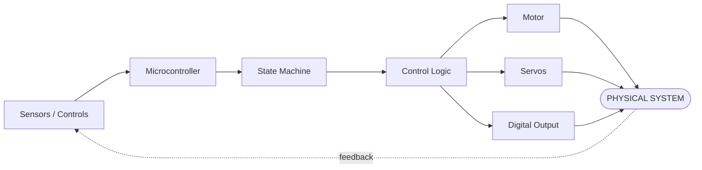

### Aircraft / Quadcopter Controller

One project uses joystick inputs, motor control, multiple servo outputs, dead-zone handling, and explicit power states.

```text
                JOYSTICKS
             A0 A1 A2 A3
                   │
                   ▼
              ┌─────────┐
              │ ARDUINO │
              └────┬────┘
                   │
                   ▼
           ┌───────────────┐
           │  STATE LOGIC  │
           └───────┬───────┘
                   │
        ┌──────────┼───────────┐
        ▼          ▼           ▼
      MOTOR      SERVOS      SAFETY
        │          │           │
        └──────────┼───────────┘
                   ▼
            PHYSICAL SYSTEM
```

```text
POWERED_OFF
     │
     ▼
   ARMING
     │
     ▼
    ARMED
     │
     ▼
POWERING_DOWN
```

The part I find most interesting is not simply generating PWM output.

It is designing the surrounding state, safety logic, interfaces, and behavior so that the system remains understandable as complexity increases.

---

## How I Approach Engineering

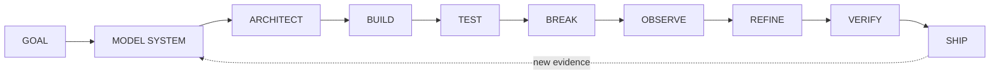

<table>
<tr>
<td width="50%" valign="top">

<h3>Before I optimize</h3>

<ul>
<li>What is the system actually supposed to accomplish?</li>
<li>Which interfaces define its behavior?</li>
<li>Which states matter?</li>
<li>What can fail?</li>
<li>What must be observable?</li>
<li>What evidence constitutes success?</li>
</ul>

</td>

<td width="50%" valign="top">

<h3>Before I call it finished</h3>

<ul>
<li>Can it be tested?</li>
<li>Can failure be reproduced?</li>
<li>Can another engineer understand it?</li>
<li>Can it recover?</li>
<li>Can it scale without architectural collapse?</li>
<li>Does the system fail visibly rather than silently?</li>
</ul>

</td>
</tr>
</table>

> **A component working is not the same thing as the system working.**

---

## System Deep Dives

<details>
<summary><strong>01 // Rasputin-Coder architecture</strong></summary>

<br>

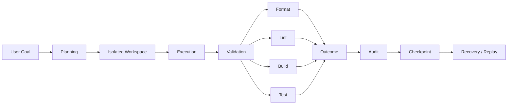

### Core engineering idea

The agent's narrative is not treated as ground truth.

Execution and validation are separated so that task completion can be based on observable system evidence.

**Technical areas**

`Rust` · `Ollama` · `Local LLMs` · `Git Worktrees` · `Terminal UI` · `State Machines` · `Validation Gates` · `Checkpoint Recovery` · `Audit Logging`

</details>

<details>
<summary><strong>02 // AURA verification pipeline</strong></summary>

<br>

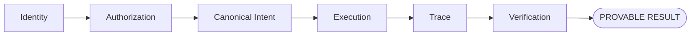

### Core engineering idea

A system should minimize the amount of correctness that exists only because another component is trusted.

**Technical areas**

`Rust` · `TypeScript` · `Canonical Data` · `Authorization` · `Cryptographic Commitments` · `Execution Traces` · `Verification` · `Threat Modeling`

</details>

<details>
<summary><strong>03 // Createch 2 integration architecture</strong></summary>

<br>

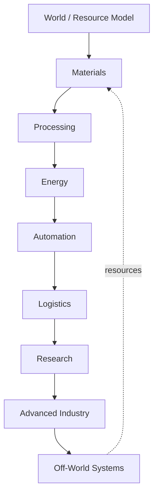

```text
INDEPENDENT SYSTEMS
        │
        ▼
┌─────────────────────┐
│  INTEGRATION LAYER  │
├─────────────────────┤
│ Configuration       │
│ Scripting           │
│ Compatibility       │
│ World Generation    │
│ Progression         │
│ Runtime Patches     │
│ Research Gating     │
└──────────┬──────────┘
           ▼
       VALIDATION
           │
           ▼
    UNIFIED SYSTEM
```

This project turns compatibility, dependencies, progression, runtime behavior, performance, and release management into one large systems-integration problem.

</details>

---

## AI + Compute

I am interested in AI primarily as a **systems problem**.

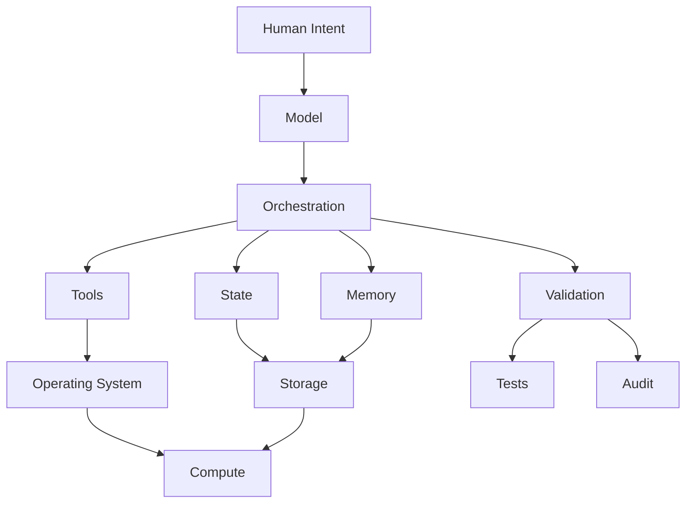

A capable model still needs:

`Boundaries` · `Tooling` · `State` · `Storage` · `Validation` · `Recovery` · `Observability`

That surrounding architecture is often the more interesting engineering problem.

---

## Hardware Direction

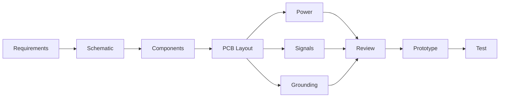

I am continuing to develop capability in:

`KiCad` · `PCB Layout` · `Digital Logic` · `FPGA` · `Grounding` · `Trace Planning` · `EMI Awareness` · `Hardware / Software Integration`

My long-term goal is to be comfortable working across the entire stack:

```text
                 PHYSICAL SYSTEM
                       ▲
                       │
                    HARDWARE
                       ▲
                       │
                    EMBEDDED
                       ▲
                       │
                    SOFTWARE
                       ▲
                       │
                 INFRASTRUCTURE
                       ▲
                       │
                SYSTEM ARCHITECTURE
```

---

## Documentation Is Engineering

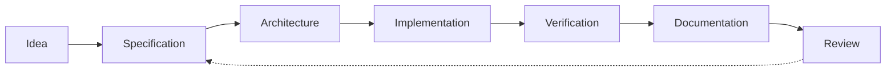

I use documentation to expose ambiguity before ambiguity becomes implementation debt.

That includes architecture documentation, protocol specifications, implementation plans, test documentation, operations material, release notes, known limitations, workflow diagrams, and design rationale.

If a complicated system cannot be explained clearly, I usually consider that evidence that some part of the architecture still needs work.

---

## Current Direction

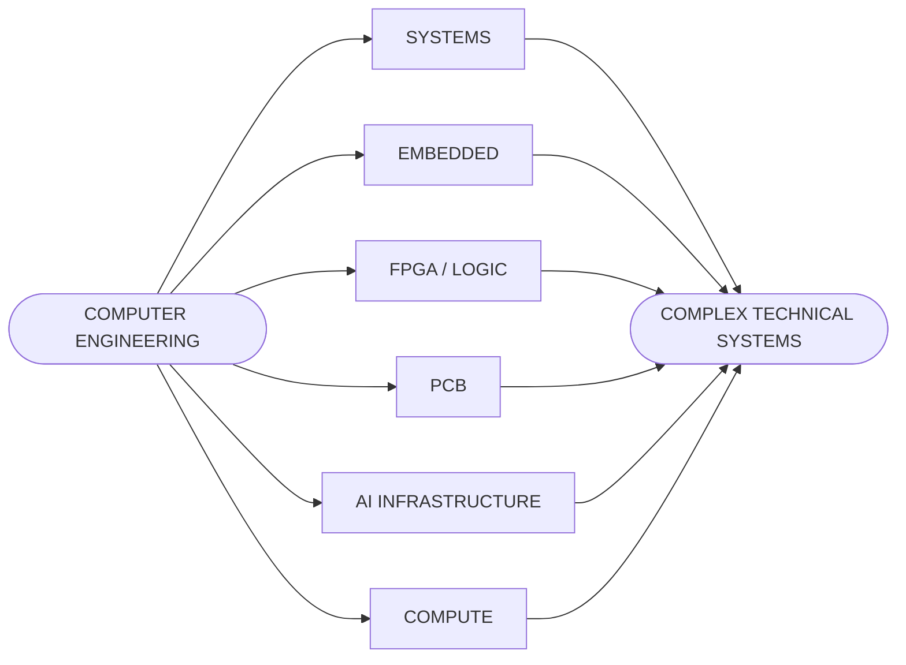

<div align="center">

<h3>AREAS I WANT TO GO DEEPER</h3>

<code>Systems Engineering</code> ·
<code>Embedded Systems</code> ·
<code>Hardware / Software Integration</code> ·
<code>Advanced Computing</code> ·
<code>AI Infrastructure</code> ·
<code>Robotics</code> ·
<code>Aerospace Systems</code> ·
<code>Defense Technology</code> ·
<code>Secure Systems</code>

</div>

---

## Shedhouse Labs

<div align="center">

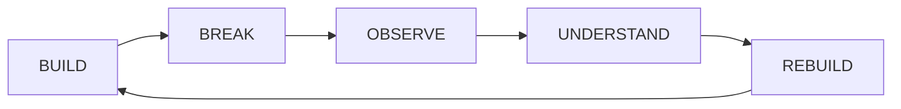

<strong>Build ambitious systems. Understand them deeply. Document what matters. Build the next version better.</strong>

</div>

---

## Start Here

<table>
<tr>

<td width="33%" align="center">

<h3>Rasputin-Coder</h3>
<p><strong>AI / Rust / Systems</strong></p>
<p>Agent architecture<br>Validation<br>State<br>Recovery</p>
<p><a href="https://github.com/Keyboard-Lord/Rasputin-Coder"><strong>EXPLORE →</strong></a></p>

</td>

<td width="33%" align="center">

<h3>AURA Protocol</h3>
<p><strong>Security / Protocols</strong></p>
<p>Authorization<br>Verification<br>Cryptography<br>Specification</p>
<p><a href="https://github.com/Keyboard-Lord/Aura-Protocol"><strong>EXPLORE →</strong></a></p>

</td>

<td width="33%" align="center">

<h3>Createch 2</h3>
<p><strong>Systems Integration</strong></p>
<p>Automation<br>Runtime Debugging<br>Configuration<br>Release Engineering</p>
<p><a href="https://github.com/Keyboard-Lord/Createch-2"><strong>EXPLORE →</strong></a></p>

</td>

</tr>
</table>

---

<div align="center">

<h3>SHEDHOUSE LABS</h3>

<code>SYSTEMS</code> ·
<code>HARDWARE</code> ·
<code>SOFTWARE</code> ·
<code>COMPUTE</code>

<br><br>

<strong>BUILD THINGS WORTH UNDERSTANDING.</strong>

<br><br>

<sub>
For technical discussion, project questions, or collaboration, contact me through GitHub.<br>
Personal contact information and private infrastructure details are intentionally not published here.
</sub>

</div>
